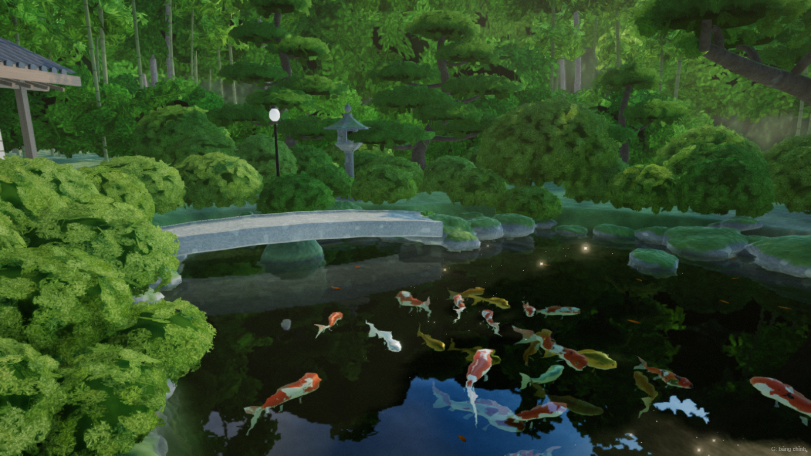

# Hồ cá koi — vườn Nhật (Three.js)



Một "bức tranh sống" 3D chạy trên trình duyệt, lấy cảm hứng từ `reference.jpg`. Camera cố định. Mọi hình khối, texture và shader đều sinh bằng code: không tải model hay ảnh nào từ mạng.

## Chạy

```bash
npm install
npm run dev        # mở http://localhost:5173
```

- `?q=low | medium | high`: mức chất lượng (mặc định `medium`). Cũng đổi được trong panel.
- Phím **G**: hiện/ẩn panel lil-gui (nắng, nước, cá, gió, hậu kỳ) và bộ đếm FPS.
- `?debug`: bật OrbitControls để xoay camera khi debug (bản thường không có).
- Tham số thử nghiệm: `?msaa=0`, `?pr=0.7`, `?p_bloom=0`, `?p_godRays=0`… (ghi đè `config.post.*`).

FPS đo trên Intel Iris Xe (GPU tích hợp), cửa sổ 1600×900: **low ≈ 80**, **medium ≈ 48**, **high ≈ 24**. Máy có card rời tầm trung sẽ chạy medium/high nhanh hơn nhiều.

## Cấu trúc

| Thư mục | Nội dung |
|---|---|
| `src/config.js` | Mọi thông số quan trọng: `QUALITY`, camera, hướng/màu nắng, màu & hấp thụ của nước, tốc độ sóng, số cá, gió, hậu kỳ |
| `src/scene/` | SDF bờ hồ + địa hình (`pond.js`, `terrain.js`), đá rêu (`rocks.js`, `stone.js`), cầu đá có gờ mép, đèn tōrō, đèn vườn, nhà (`structures.js`), nền rừng xa (`backdrop.js`), ánh sáng + Sky + PMREM (`lighting.js`) |
| `src/water/` | Shader composite mặt nước (`waterPass.js`), normal map lăn tăn tileable (`normalMap.js`), ripple buffer (`ripples.js`) |
| `src/koi/` | Geometry cá (thân, vây đuôi/lưng/ngực/bụng, râu), shader hoa văn 9 giống, boids |
| `src/vegetation/` | Hệ lá instanced card (gió, xuyên sáng giả, AO nướng sẵn), thông niwaki, đỗ quyên karikomi, tre, rừng nền, lá rơi trôi trên nước |
| `src/post/` | Pipeline: SAO, god rays (ray-march shadow map), bụi trong nắng, DOF, bloom, ACES + chỉnh màu + vignette + grain, FXAA |
| `scripts/` | `shoot.mjs` (Playwright: chụp 1600×900 + ảnh so sánh cạnh `reference.jpg`), `fps.mjs`, `prof.mjs` (thời gian từng pass) |

## Nước làm thế nào

Mặt nước là mặt phẳng y = 0, được tính trong một pass toàn màn hình. Pixel nào có cảnh nằm dưới mặt phẳng và ở trong SDF của hồ thì được tô thành nước:

- **Sóng nhỏ**: 3 lớp normal map trôi theo các hướng và tốc độ khác nhau, cộng thêm vòng gợn từ ripple buffer (giải phương trình sóng 2D) khi cá ngoi lên đớp.
- **Phản chiếu**: render cảnh bằng camera lật qua mặt nước (cắt bỏ phần y < 0), lấy mẫu méo theo normal.
- **Fresnel (Schlick, F0 = 0.02)**: nhìn gần thì trong, nhìn xa thì phản chiếu nhiều.
- **Khúc xạ**: lệch UV theo normal, bỏ mẫu nếu rơi vào vật nằm trên mặt nước.
- **Beer–Lambert**: theo quãng đường ánh sáng đi trong nước (lấy từ depth buffer), cộng tán xạ màu xanh rêu đậm.
- **Lấp lánh**: specular sắc từ normal sóng, cộng các vi diện mao dẫn ngẫu nhiên; chỉ xuất hiện ở chỗ có nắng.
- **Caustics** (Voronoi động, chiếu theo hướng nắng) và suy giảm ánh nắng theo độ sâu, áp lên đáy hồ, đá và lưng cá.
- **Bóng lá lốm đốm** trên mặt nước: lấy mẫu PCF trực tiếp từ shadow map của mặt trời.

## Ghi chú

- Three.js r187 đã bỏ `PCFSoftShadowMap`, nên bóng mềm dùng `PCFShadowMap` với `shadow.radius`.
- Trên GPU Intel, depth texture float32 kèm MSAA resolve rất chậm, nên cảnh chính dùng depth 24-bit.
- Ảnh chụp lần đầu và lần cuối nằm trong `screenshots/` (`s1_compare.png`, `final_compare.png`).
